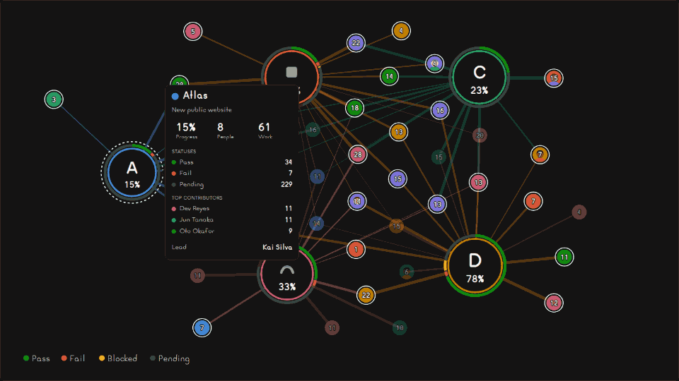
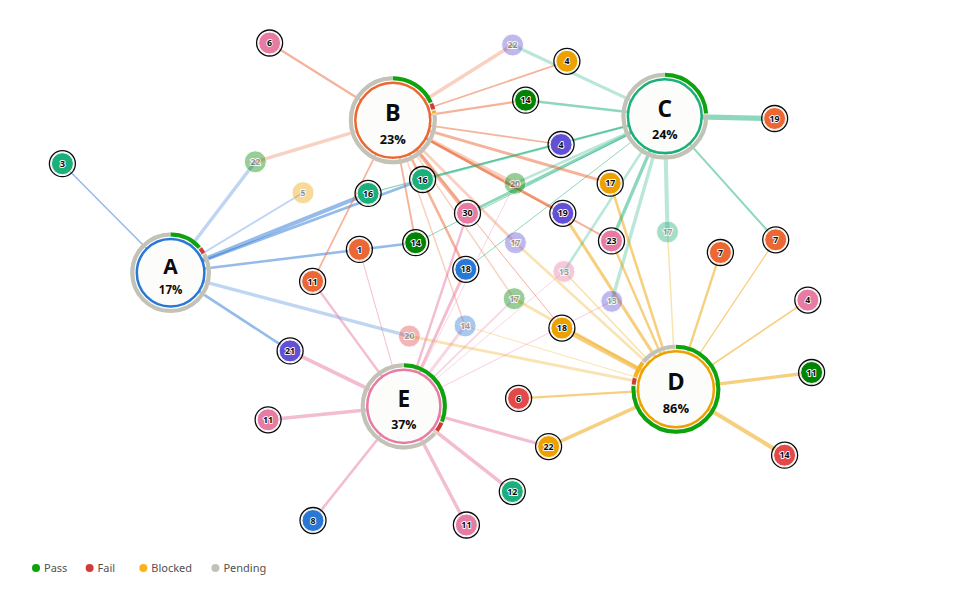

# <picture><source media="(prefers-color-scheme: dark)" srcset=".github/assets/icon-dark.svg"></picture> tequio

[](https://www.npmjs.com/package/@npmegar/tequio)
[](https://bundlejs.com/?q=@npmegar/tequio)
[](LICENSE)

Live participation graph: projects at the center, people around, links as thick as the work. TV and print.



**[Live demo](https://ghegar.github.io/tequio/)**

tequio owns the picture and its motion: a force layout of its own that runs in `requestAnimationFrame`
and moves the DOM through refs, positions remembered between updates so the graph never jumps, pulses
on the nodes whose numbers changed, and a deterministic export to SVG and PNG. You own the data and
the colors: two themes ship as plain token objects (dark for a TV, light for print) and every token can
be overridden. Names never appear on the canvas; they live in `<title>`, `aria-label` and the table view.

## Install

```bash
npm install @npmegar/tequio
```

| Entry | What it is | Needs |
|---|---|---|
| `@npmegar/tequio` | Model, simulation, store, scene, themes, `toSvg` and `toPng` | nothing (`toPng` needs a browser) |
| `@npmegar/tequio/react` | `<Tequio>`, `useTequio`, `<TequioTable>` | `react >= 19` |
| `@npmegar/tequio/element` | `<tequio-graph>` custom element, fed by a URL or a property | `react`, `react-dom` |
| `@npmegar/tequio/standalone` | The same element with React bundled, for a plain `<script>` | nothing |
| `@npmegar/tequio/schema.json` | JSON Schema of the data, for any language | nothing |
| `tequio` (bin) | `tequio render` and `tequio validate` from JSON or CSV | Node; PNG needs `@resvg/resvg-js` |

## Quick start

```tsx
import { Tequio } from '@npmegar/tequio/react';
import type { GraphData } from '@npmegar/tequio';

const data: GraphData = {
    statuses: [{ key: 'done', label: 'Done', tone: 'good' }, { key: 'todo', label: 'To do', tone: 'neutral' }],
    projects: [{ id: 'web', name: 'Website', progress: 0.6, counts: { done: 6, todo: 4 } }],
    people: [{ id: 'ana', name: 'Ana', metric: 6, active: true }],
    links: [{ person: 'ana', project: 'web', weight: 6 }],
};

export const Wall = () => <Tequio data={data} theme="dark" table />;
```

The SVG scales to its container through `viewBox`; give the container a size, such as `100vw` × `100vh` on a TV.

## Preparing your data

1. Pick what a **link weight** measures: tasks closed, hours, commits. It sets the link width and pulls
   heavier contributors closer to the project.
2. Pick the **metric** printed inside each person: usually the sum of their weights, but any number works.
3. List the **statuses** once, in ring order. Each project only sends `counts` by status key.
4. Send a **new object** on every update. The store skips the same object twice and pulses the nodes
   whose `progress`, `counts`, `metric` or `active` changed.

| Field | Drawn as |
|---|---|
| `project.progress` (0–1) | only in the info box, as a percentage |
| `project.counts` | segmented ring around the project, in `statuses` order |
| `project.logo` | image inside the project; without it, the initial |
| `project.color` | identity ring and link color (default: theme palette by order) |
| `person.metric` | number inside the person |
| `person.avatar` | photo behind the number; without it, `person.color` |
| `person.active` | outer ring when active, faded when `false` |
| `description`, `details` | only in the info box: a paragraph and label/value rows (`href` allowed) |
| `link.weight` | link width and length, relative to the heaviest link |

Every person has the same size. Projects grow with the total weight of their links.

## From any system

The data is a plain JSON contract, published as [`schema.json`](schema.json). Any backend can emit it
without depending on tequio; `validate(data)` returns every problem with its path, and warnings for
what would be skipped (a link to a missing person, a count for an undeclared status).

Most systems already have a table of work: one row per task, case or ticket. `fromRows` turns it into
the contract by naming its columns:

```ts
import { fromRows, parseCsv } from '@npmegar/tequio';

const data = fromRows(parseCsv(csv), { person: 'owner', project: 'repo', status: 'state', weight: 'hours' });
```

| Mapping | Default | Becomes |
|---|---|---|
| `person`, `project` | required | ids (and names, unless `personName`, `projectName`) |
| `status` | — | counts per project; tones guessed from words like *done*, *failed*, *blocked*, *pending*, also in Spanish |
| `weight` | 1 per row | link weights and each person's metric |
| `active` | — | `true` if any row says yes |
| `open` | neutral statuses | statuses not done yet, for `progress`; or pass `progress(rows)` |

Each field takes a column name or a function of the row. `parseCsv` handles quotes, BOM and `,` `;` or
tab separators.

## Command line

```bash
npx @npmegar/tequio render work.csv --status state --weight hours -o participation.svg
npx @npmegar/tequio render data.json --theme dark --width 1600 --height 900 -o wall.png
npx @npmegar/tequio validate data.json
```

Input is a contract JSON, a JSON array of rows or a CSV (`-` reads stdin). Output goes to stdout unless
`-o` is given; PNG needs `@resvg/resvg-js` installed next to it. Run `tequio --help` for every option.

## Web component

For a wall screen or any page without React, one script and one tag are enough:

```html
<script type="module" src="https://unpkg.com/@npmegar/tequio/dist/standalone/tequio-graph.js"></script>
<tequio-graph src="/api/participation" token="…" refresh="30" theme="dark" tour="8000,15000" locale="es"></tequio-graph>
```

| Attribute | Default | |
|---|---|---|
| `src` | — | URL of the data; `refresh` seconds between polls (`0` once). Failed polls keep the last graph and back off |
| `token` | — | sent as `Authorization: Bearer`; use a read-only token and serve the page privately |
| `theme`, `locale` | `dark`, `en` | `locale` also picks built-in Spanish text (`es`) |
| `tour` | off | present, or `idle,interval` in ms |
| `info`, `focus`, `legend`, `table` | on | `"false"` turns them off |
| `width`, `height` | 1920, 1080 | canvas units |

Set `element.data = graph` instead of `src` to feed it yourself. It emits `tequio-load`, `tequio-error`
and `tequio-node` (`{ id, kind, name }`) and renders in its own shadow root. With npm, import
`defineTequio` from `@npmegar/tequio/element` and call it once. See [the wall page](https://ghegar.github.io/tequio/tv.html).

## Themes

`dark` and `light` are token objects (`background`, `surface`, `text`, `muted`, `track`, `font`,
`palette`, `tones`, `linkOpacity`, `inactiveOpacity`). Pass a name or partial overrides:

```ts
const theme = { base: 'light', font: 'Inter, sans-serif', tones: { critical: '#b42318' } } as const;
```

Status colors come from `status.color`, then from its `tone`, then from the palette (the validated
eight-hue categorical order). Text uses ink tokens with a surface halo, never a series color.

## Layout

`layout` (`width`, `height`, `padding`, `legend`, `personRadius`) is in 1920×1080 units and scales
with the canvas; nothing lands under the legend band. The simulation uses d3-force's vocabulary
(`forces`, `cooling` with `alphaDecay` and `alphaTarget`); live graphs keep a small `alphaTarget` so
they breathe.

## Export

```ts
import { toPng, toSvg } from '@npmegar/tequio';

const svg = toSvg(data, { theme: 'light', layout: { width: 1600, height: 1000 }, focus: 'u:ana' });
const png = await toPng(data, { theme: 'light', scale: 2 });
```

`toSvg` builds, settles and serializes without a DOM, so it runs in Node, in a worker or at build time.
The same data and options always give the same string. `focus` takes a node id (`p:` for projects,
`u:` for people) to dim everything else, for a per-person or per-project figure. `toPng` inlines remote logos and avatars as
data URIs before drawing, so the canvas is never tainted.



## Info box

Clicking a node opens a card next to it; Escape, the close button or a click elsewhere closes it.
`infoPlan(graph, id)` decides everything (title, cards, rows, formatted values) and `<InfoBox>` only
paints the plan with theme tokens, inside the SVG so it scales with the screen and follows the node.

| Node | Card |
|---|---|
| Project | progress, people and work; counts per status; top contributors; `description`; `details` |
| Person | active badge; metric and project count; projects with their weight; `description`; `details` |

The card goes above, below, right or left of the node, whichever fits, and is clamped to the canvas.
Hrefs in `details` pass only for `http(s):`, `mailto:`, `tel:` and relative paths.

**Tour.** With `tour`, a wall display explains itself: after `idle` ms without input it opens a card on
every data update (or every `interval` ms), starting with the nodes that just changed and otherwise
going round. Any pointer, wheel or key input stops it until the graph is idle again.

```tsx
<Tequio data={data} tour={{ idle: 8000, interval: 15000 }} infoLabels={{ progress: 'Avance' }} />
```

## Core

| Function | Does |
|---|---|
| `buildGraph(data, { layout, memory })` | Nodes and links, positions from memory or a hash of the id |
| `remember(graph, memory)` · `changes(graph, memory)` | Keep positions; list the nodes to pulse |
| `step` · `settle` · `cool` | One tick, many ticks, alpha decay |
| `createStore({ layout, forces })` | `update(data)`, `subscribe`, `getSnapshot`, `clearPulses` |
| `infoPlan(graph, id)` · `infoPlacement(graph, node, plan)` | What the info box says, and where it goes |
| `focusOf(graph, id)` · `linkEnds(link, scale)` | Neighbors to keep in focus; link ends on the outer edge of each node |
| `buildScene(graph, options)` | Shapes per node, links, legend and labels: what any renderer draws |
| `sceneToSvg(scene)` | Serialize a scene |

## React

```tsx
<Tequio data={data} theme="dark" animated onNode={(node) => open(node.data.id)} table />
```

| Prop | Default | |
|---|---|---|
| `theme` | `'dark'` | name or overrides |
| `animated` | `true` | `false` draws once; `prefers-reduced-motion` turns motion and pulses off |
| `info` | `true` | clicking a node opens its info box; nodes become focusable buttons (Enter and Space) |
| `tour` | `false` | `true` or `{ idle, interval }`: open cards by themselves while nobody interacts |
| `focus` | `true` | while a card is open, dim everything but the node, its direct neighbors and their links |
| `renderInfo` | — | `(plan) => node` to paint the card yourself |
| `onNode` | — | called on click or Enter with the node |
| `table` | `false` | renders `<TequioTable>` visually hidden after the SVG |
| `layout`, `locale`, `labels`, `legend`, `forces`, `cooling`, `background` | | as in the core |

`useTequio(data, options)` returns `scene`, `pulses` and `register` for your own SVG: render the
scene and pass `register({ kind: 'node', id })` or `register({ kind: 'link', id })` as the ref. Only
nodes whose fingerprint changed re-render; motion never goes through React.

## Known limitations

- Built for tens of projects and a few hundred people: the repulsion is pairwise, without a quadtree.
- More than eight projects reuse palette hues; logos, initials and the table keep them apart.
- The light palette has three hues under 3:1 against white; the legend text and table view carry them.
- Fonts are not embedded in exported SVG or PNG: use a font the reader has, or a system stack.

## Development

```bash
npm test
npm run lint
npm run typecheck
npm run build
npm run demo
npm run e2e
```

The demo shows five projects and forty people whose data changes every fifteen seconds, touring its
nodes when left alone, with a TV mode (full screen), both themes and SVG/PNG export.
`?projects=10&people=150` loads a stress size. Its production build holds 60 fps at 1920 × 1080 with 150 people and the tour running.

## Contributing

Issues are welcome. Open one before sending a pull request.

## License

AGPL-3.0-only © GHEgar
